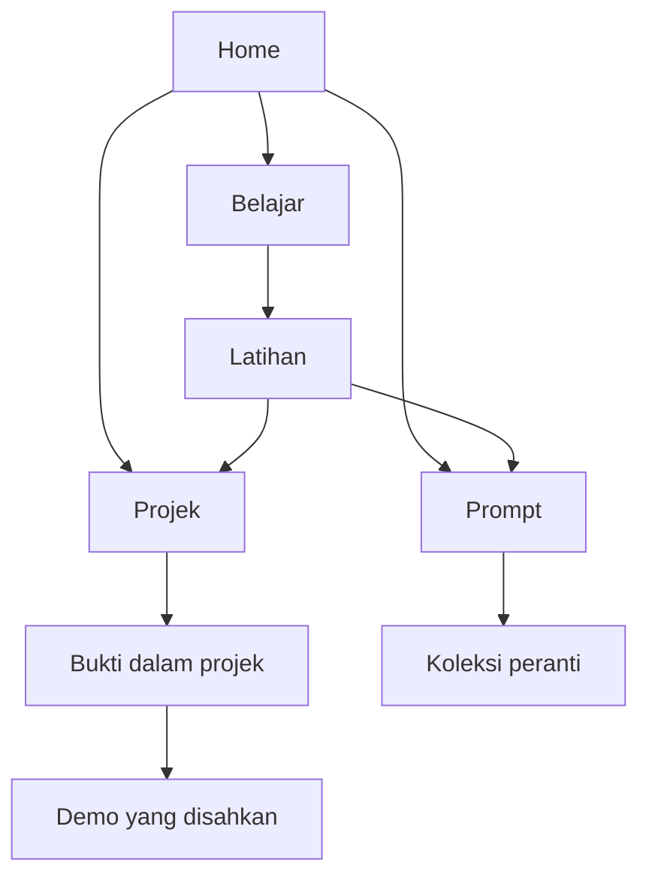

# AICHEATCODE — Pelaksanaan V2.0

Semakan: 3 November 2026 (MYT). **Status keseluruhan: BLOCKED untuk penerimaan produksi. Kod integrasi tersedia; belum diterbitkan.**

## A. Executive technical audit

Laman live masih Versi 4. Kod asal ialah Vinext, JavaScript biasa, Cloudflare Worker dan D1 (`editor_state`). Satu Site melayani cannybrainy.com dan subdomain Prompt Playground; kedua-duanya bukan projek sumber berasingan. Tiada framework baharu, akaun pengguna baharu atau langganan berbayar diperkenalkan.

Audit pelayar production mengesahkan Home masih berpusat pada direktori prompt dan mempunyai empat pautan alat. Carian `caption restoran` menghasilkan 2 tugasan / 11 varian. Kategori teknologi menghasilkan 129 tugasan / 10,079 varian. Ini menafikan dua aduan sifar hasil pada binaan live semasa. Bukti: `public/evidence/prompt.jpg`; tarikh dan persekitaran dicatat dalam registry.

Pemeriksaan HTTP production dari executor menerima 403 bagi domain Sites, walaupun pelayar boleh menggunakannya. Oleh itu status HTTP, canonical, robots dan sitemap production semasa **BLOCKED**, bukan bukti laman down. Respons Netlify boleh dibaca: Belajar Arab sekitar 10,623,077 bait HTML awal; Courses Free AI 185,116 bait. Jangan embed atau memuatkan aplikasi berat secara automatik.

**Halangan kritikal:** Pratonton managed melaporkan berjalan tetapi pelayar menerima `ERR_CONNECTION_REFUSED`. Kunci Vinext lama telah dibersihkan selepas preview dihentikan; ralat sambungan masih berlaku. Tiada pengubahsuaian network, server alternatif atau pemintasan polisi dibuat. Visual, responsive dan E2E binaan baharu belum boleh disahkan.

## B. Master project inventory

[Master Project Registry](MASTER_PROJECT_REGISTRY.md) menyenaraikan 25 rekod diketahui. Sumber penuh: `lib/registry.json`; 13 rekod Sites mentah dalam `verification/sites-inventory.json`. Carian Library turut menemui Study Assistant, Learning Path, beberapa ZIP Math, tutorial Canva dan ZIP Visual Resume Studio. Google Drive menemui pangkalan data dan dua folder Visual Resume Studio yang tidak dikongsi. Tiada rekod pemohon dibaca.

Setiap rekod memegang ID, slug, tujuan, audiens, sumber, URL asal jika tersedia, hosting/stack, status, akses, fungsi, bukti, tarikh, batasan, risiko penyelenggaraan, cadangan penempatan dan keputusan KEEP / REPAIR / MERGE / INVESTIGATE. UNKNOWN digunakan apabila bukti tidak cukup. Tiada projek diarkib atau dipadam. Inventori ini bukan dakwaan semua fail akaun telah diaudit byte demi byte.

Motion Lab, Math, Learning Path dan beberapa penerbitan Sites mempunyai akses terhad. Mereka mendapat halaman projek dengan status jujur; tiada butang demo awam yang membuka dinding log masuk. Visual Resume Studio mempunyai sumber, tetapi PDF end-to-end dan URL web app belum disahkan. Dua folder bernama sama ialah isu provenance yang perlu diselesaikan dahulu.

## C. Final architecture

Navigasi utama: **Home | Belajar | Prompt | Projek | Tentang**.

| Halaman | Tujuan berbeza | Pemilik kandungan | Hubungan utama |
|---|---|---|---|
| `/` | Orientasi, empat bidang dan langkah mula | Kod portal | Belajar, latihan, projek |
| `/belajar` | Memilih kemahiran | `lib/hub.mjs` | Empat tutorial dan Study Lab |
| `/belajar/:slug` | Objektif, alat, langkah, aktiviti dan hasil dijangka | Kandungan pendidikan disemak melalui Git | Prompt dan projek berkaitan |
| `/belajar/study-lab` | Aktiviti nota → kad → kuiz | Derivatif Study Assistant asal | Case study dan muat turun HTML offline |
| `/prompt` | Cari dan tapis arahan | Dataset asal + penerbitan D1 | Butiran prompt, pembina, panduan, koleksi |
| `/bina`, `/panduan`, `/koleksi`, `/sumber-status` | Tugas alat yang berlainan | Kod alat / storan peranti / D1 | Subnavigasi Prompt |
| `/projek` | Direktori aplikasi dan aset, bukan direktori tutorial | `lib/registry.json` | Case study setiap projek |
| `/projek/:slug` | Tujuan, bukti, status, batasan dan demo sah | Registry + bukti | Belajar dan aplikasi luar |
| `/tentang` | Misi dan hubungan ARTSCIPES | Kod portal | Privasi, komuniti dan sumber |
| `/privasi` | Storan peranti, domain dan batasan privasi | Kod portal | Eksport koleksi dan pengurusan data asal |
| `/?legacy=1` | Eksperimen visual asal dan CMS reka bentuk asal | Editor D1 sedia ada | Semua fungsi lama dipelihara |

Empat bidang kekal AI Prompt, Canva Tutorial, Creative AI dan Brand Studio. Tiada halaman Bukti utama tambahan. Semua halaman baharu wujud untuk niat pengguna yang berbeza, bukan penambahan kata kunci.

**Laluan lama:** URL alat dan ID prompt kekal. Hash lama diterjemah oleh router; hash pada Home baharu diarahkan ke laluan alat yang sepadan. Varian berkongsi canonical tugasan; sitemap tidak menyenaraikan 100,000 variasi. Tiada redirect domain paksa: storan pelayar berbeza antara cannybrainy.com dengan subdomain, maka redirect boleh menyembunyikan koleksi lama sebelum eksport.

## D. UX and functional defect register

| ID | Keutamaan | Bukti / punca | Pelaksanaan / semakan semula |
|---|---|---|---|
| UX-01 | P1 | Home live hanya empat alat prompt; tiada pintu Belajar/Projek | Portal lima bahagian dibina dalam Site sama; SSR/link tests PASS; visual/E2E BLOCKED |
| UX-02 | P1 | Projek terpisah, status akses tidak seragam | Registry + 25 case pages; demo terhad tidak dipaparkan; sumber tests PASS |
| DATA-01 | P1 | 531 kumpulan tajuk berulang; 100,571 teks unik | Pengelompokan tugasan sedia ada dikekalkan: 1,071 tugasan, 90 halaman pada 12 setiap halaman |
| SEARCH-01 | Resolved / not reproduced | caption restoran → 2 tugasan / 11 varian pada production | Pelayar semasa dan regresi sumber PASS |
| SEARCH-02 | Resolved / not reproduced | kategori teknologi → 129 tugasan / 10,079 varian | Pelayar semasa dan regresi sumber PASS |
| STATE-01 | P1 | Aduan kehilangan input; ujian pelayar 2 November lulus | Kod draf tidak diganti; ujian reload/tukar nilai sumber PASS; E2E binaan baharu BLOCKED |
| SAVE-01 | P1 | Aduan menyimpan templat asal | Laluan simpan adaptasi dikekalkan; ujian 2 November menunjukkan teks eksport tepat; regresi sumber PASS; UI baharu BLOCKED |
| COPY-01 | P1 | Clipboard bergantung pelayar/izin | Fallback asal dikekalkan; bukti copy 2 November bukan pensijilan semua peranti; E2E semasa NOT TESTED |
| SEO-01 | P1 | Shell HTML asal sama merentas laluan, tanpa metadata route khusus dalam kod asal | SSR, metadata, canonical, sitemap, robots, 404 dan noindex peribadi dibina; 12 handler tests PASS; production pending |
| PERF-01 | P1 | Data prompt 2.89 MB mentah dimuatkan oleh aplikasi asal di semua halaman | Home/Belajar/Projek baharu tidak memuatkan app.js atau dataset; source tests PASS; Core Web Vitals NOT TESTED |
| A11Y-01 | P1 | Responsive dan aliran keyboard baharu tidak boleh dilihat akibat preview | Gate BLOCKED; tiada dakwaan WCAG penuh |
| SOURCE-01 | P1 | Tiada medan URL sumber rasmi berstruktur dalam semua rekod materialized | UI sumber dilabel UNVERIFIED; tidak meneka provider atau menambah filter model palsu |

Journey A baharu: Home → Belajar → tutorial atau Study Lab → aktiviti. Journey B: Home → Prompt → carian → adaptasi → copy. Journey C kekal koleksi peranti. Journey D: Home → Projek → bukti → demo sah. Journey E memerlukan viewport/keyboard E2E; BLOCKED. Journey F mempunyai HTML bermakna tanpa dataset prompt; tiada ukuran rangkaian pengguna sebenar. Tiada kajian peserta atau kadar kejayaan pengguna direka.

## E. Content and database specification

**Autoritatif dalam pelepasan ini:** dua fail data asal dan satu fail tambahan pemilik. `verification/data-audit.json` mengira 100,571 ID unik, 100,571 hash teks unik, tiada ID pendua, tiada medan wajib kosong dan tiada aksara replacement U+FFFD. `verification/csv-integrity.json` membandingkan semua 100,000 baris CSV asal, teks dan metadata: 0 perbezaan; SHA-256 sepadan `5a36b7cdce82d76ae222e2dd7418e7637b90b4c0d38026916db227e544fb2272`.

Bilangan spreadsheet/PDF terdahulu tidak dijumlahkan sebagai prompt tambahan tanpa deduplikasi. Missing source URL tidak bermakna tiada fail sumber: provenance fail asal masih ada. Ia bermakna pautan penerbit dan hak rasmi belum disahkan. Status rasmi tidak diteka daripada nama AI dalam teks. Provider filter tidak ditambah kerana metadata tidak menyokongnya.

D1 `editor_state` diperiksa melalui alat Sites: 0 baris pada semakan ini. Tiada migration atau penulisan produksi dilakukan. Published overrides, pengasingan draft dan revision checks sedia ada kekal. Registry/tutorial statik dikawal melalui Git; tiada CMS baharu atau login awam diperkenalkan. Editor prompt masih boleh menyunting tambahan USER-IA-001 selepas pembaikan pemuatan curated data; editor reka bentuk asal menunjuk ke eksperimen asal, bukan memberi gambaran palsu ia menyunting semua kandungan portal.

Saved prompts kekal pada key `aicheatcode-playground-v1`: `saved[]`, `custom[]`, dengan ID/sourceId dan teks adaptasi berasingan daripada sumber. Draf kekal pada `aicheatcode-drafts-v1`. Penanda pembelajaran baharu menggunakan key berasingan `aicheatcode-learning-progress-v2`. Tiada penghijrahan key atau penghapusan koleksi.

[content-model.sql](content-model.sql) ialah spesifikasi masa hadapan, **bukan migration diterapkan**. Ia menetapkan PK/FK, uniqueness, indeks dan status bagi Projects, Evidence, Sources, Prompts, Versions, Tutorials, Categories, Paths dan Lessons. Ia diparse dalam SQLite memori untuk semakan sintaks. Saved Prompt kekal browser-local sehingga keperluan cross-device, authorization dan persetujuan ditetapkan.

Migration selamat: eksport sumber + D1 dahulu → checksum → dry-run ke jadual baharu → bandingkan ID/hash/count → canary → transaksi/peralihan terkawal → simpan sumber lama sehingga rollback disahkan. Ia tidak diperlukan untuk integrasi berasaskan JSON ini.

## F. Actual implementation

- `lib/hub.mjs`, `registry.json`, `site-response.ts`: portal, tutorial, case study, metadata dan pengendali route.
- `public/hub.css`, `hub.js`: editorial putih / Ink / Blue / Orange, menu dan kemajuan setempat, pemeliharaan hash lama.
- `public/prompt-brand.css`: penjajaran warna dan kawalan pada alat sedia ada; kod data/state tidak diganti.
- `public/tools/study-lab*.html`: derivatif sumber Study Assistant asal; versi BM/EN dan muat turun self-contained. Validasi istilah serta penerangan unik ditambah. Tiada API model.
- `app/route.ts`, catch-all: SSR laluan awam, kandungan prompt asas, canonical tugasan, 404 sebenar.
- `public/admin.*`: curated prompt boleh ditemui dalam editor; preview asal dikekalkan dengan `?legacy=1`.
- `public/app.js`, `workflows.js`: peta laman lima bahagian, provenance belum disahkan dan navigasi kembali ke portal.

Tiga fail data asal tidak berubah berbanding commit Versi 4. Aset visual/gerakan asal dan fungsi asal masih dalam sumber serta laluan eksperimen. Tiada duplicate disconnected Site dicipta.

BM/EN disediakan pada kandungan portal dan Study Lab. Antaramuka alat Prompt kekal BM, dengan teks sumber BM/EN asal. Kekurangan terjemahan alat dinyatakan; tiada toggle EN yang berpura-pura menterjemah semua 100,571 prompt. Tema gelap tidak ditambah kerana belum diuji.

## G. QA evidence

| Suite / environment | Status | Had bukti |
|---|---|---|
| 76 integration source/SSR checks | PASS | Registry, route HTML BM/EN, satu H1, canonical, links, escaping, data hash, restricted-demo gating; bukan render browser |
| 12 actual handler tests in Node | PASS | Home/legacy/study/prompt/private/404/robots/sitemap/headers/EN; D1 writes tidak diuji |
| Existing catalog regression | PASS | Count, IDs, filters, pagination, override/deletion rules |
| Existing workspace regression | PASS | Adaptation reload, builder restoration, filters, storage failure |
| TypeScript noEmit | PASS | Binding D1 pilihan kini diperiksa; API memulangkan 503 jika DB tidak tersedia |
| Existing editor merge/validation | PASS | Draft isolation, revision/data validation logic |
| CSV 100,000-row comparison | PASS | Semua teks dan metadata, bukan keberkesanan AI |
| Token color calculations | PASS | Ink/white 18.38, Blue/white 8.81, muted/white 7.44; bukan audit semua state CSS |
| Production search/category browser | PASS | Dua aliran terhad pada Versi 4 |
| New-build browser, Study Lab click/grade/copy/download | BLOCKED | Pratonton tidak dapat disambung |
| 320 / 390 / 768 / 1024 / 1440 viewport | NOT TESTED | Binaan baharu tidak dapat dirender dalam browser |
| Full WCAG, screen reader, Safari/Firefox/physical phone | NOT TESTED | Tiada sijil pematuhan |
| Dependency vulnerability audit | BLOCKED | pnpm audit exit 1 tanpa hasil yang boleh ditafsir; status kerentanan tidak diketahui |
| LCP / INP / CLS, Lighthouse, field data | NOT TESTED | Tiada markah prestasi direka |
| Backend authorization production write | NOT TESTED | Pengubahsuaian destruktif/produksi tidak dijalankan |

CSP ditambah sebagai **Report-Only**, bukan perlindungan enforced yang telah disahkan. Output dinamik di-escape dan URL HTTPS disemak. Iframe Study Lab dibatasi `sandbox=allow-scripts`; mesej saiz disemak terhadap window iframe dan had nombor. Semakan corak secret tidak menemui padanan dalam public/lib, tetapi ini bukan pensijilan keselamatan. Tiada token atau API key dimasukkan dalam kod frontend.

## H. Deployment package and rollback

Penerbitan **belum dilakukan**, mengikut arahan eksplisit pengguna. Sumber dipush dan versi disimpan sahaja. Arkib binaan bukan bukti production QA.

Binaan asal: commit `e9b1aa3bcd14365c2747ac99b3298a9f495d2037`, saved Version 4 `appgprj_6adcb8a45cec8191ab42c0dfbd4e8d3a~appgver_4a9d2f46f7888191ae08bb4832dcd368`. Backup Git bundle dibuat sebelum perubahan; data sumber diverifikasi checksum. D1 tidak diubah. Bindings kekal DB; R2 kekal tidak digunakan. Memerlukan Node >=22.13 dan dependencies lockfile; gunakan helper build Sites untuk Vinext Worker.

Urutan pelepasan: pulihkan preview → uji E2E/viewport/bahasa/aksesibiliti → baiki kegagalan → bina semula dari sumber tepat → minta kelulusan → deploy saved version → semak production HTTP dan interaksi pada domain utama → hanya kemudian tandakan production accepted. Jangan gunakan deploy sebagai ganti preview yang gagal tanpa persetujuan.

Rollback: deploy semula saved Version 4 menggunakan tool Sites setelah diizinkan; tiada schema rollback diperlukan. Jangan padam localStorage, ubah audience atau redirect domain ketika rollback. Jika ada penulisan D1 selepas pelepasan, eksport state/revision terlebih dahulu dan bandingkan sebelum pemulihan.

## I. Acceptance

**NOT COMPLETE / BLOCKED untuk produksi.** Implementasi dan ujian sumber tersedia. Data preservation PASS. Search/filter live asal PASS. Portal source/routing checks PASS. Visual, responsive dan interaksi integrasi baharu belum diverifikasi. Tidak wajar meminta kelulusan production-ready sebelum gate ini selesai.

## J. Priorities

1. P0: pulihkan akses preview managed dan jalankan semua journey serta lima viewport.
2. P0: uji Study Lab invalid/Unicode/HTML input, markah betul/salah, retry dan muat turun offline; uji prompt save/copy/reopen/delete pada binaan integrasi.
3. P1: jalankan audit dependency yang menghasilkan advisori sah; audit accessibility pada DOM sebenar dan state interaktif.
4. P1: tentukan akses demo awam bagi Motion Lab/Math/Learning Path tanpa mengubah permissions secara tersirat.
5. P1: padankan dua folder Visual Resume Studio dan sahkan web app/PDF tanpa mendedahkan data pemohon.
6. P2: verifikasi sumber rasmi dan lesen prompt satu demi satu sebelum status OFFICIAL/provider filter.
7. P2: terjemahan penuh UI Prompt, kandungan tutorial lebih mendalam, dan pengurangan payload/audio Belajar Arab pada repositori aplikasinya sendiri.

### Rujukan teknikal rasmi

- Google canonical: https://developers.google.com/search/docs/crawling-indexing/consolidate-duplicate-urls
- JavaScript SEO: https://developers.google.com/search/docs/crawling-indexing/javascript/javascript-seo-basics
- WCAG 2.2: https://www.w3.org/TR/WCAG22/
- Target size: https://www.w3.org/WAI/WCAG22/Understanding/target-size-minimum
- OWASP output encoding: https://cheatsheetseries.owasp.org/cheatsheets/Cross_Site_Scripting_Prevention_Cheat_Sheet.html
